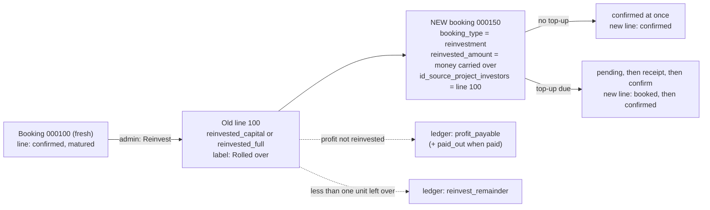
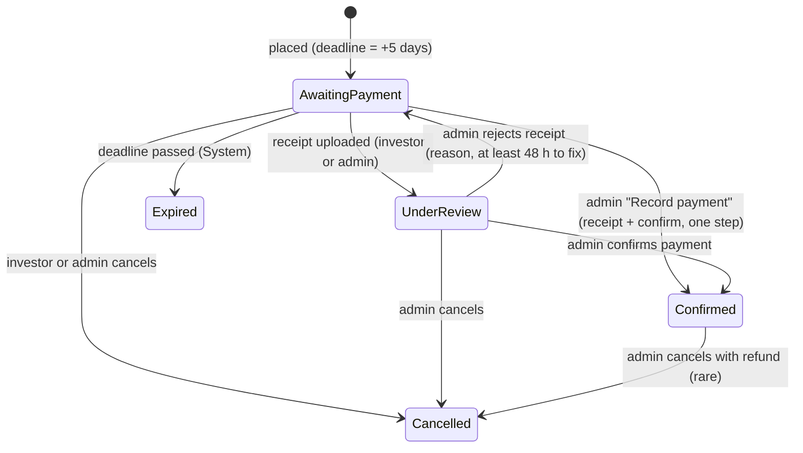
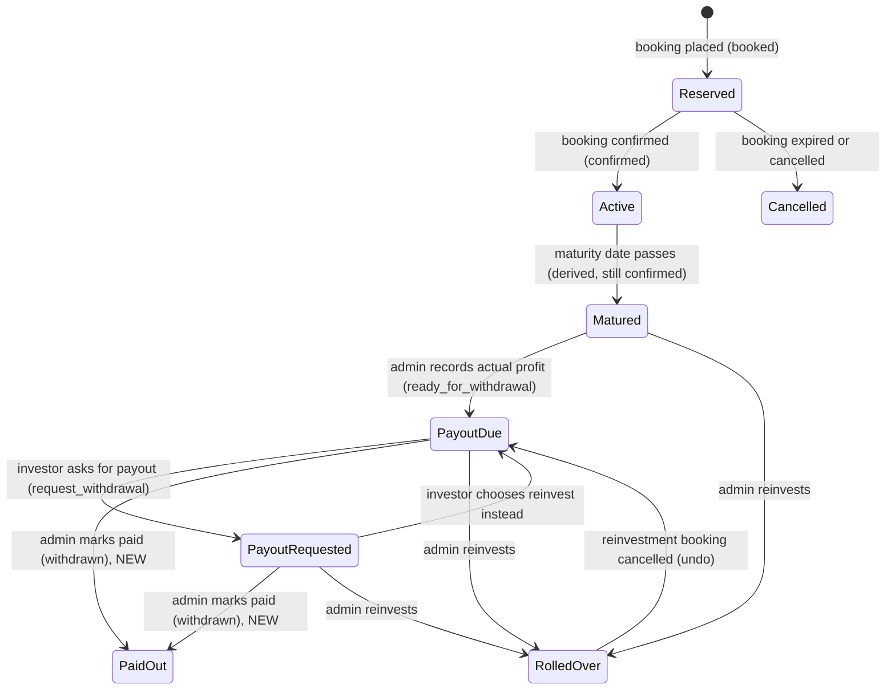

# Booking lifecycle, unit holds and the 5-day payment window

Analysis of how bookings and investments move through their statuses today,
how "units left" is calculated, and a plan to:

1. count booked-but-unpaid units when showing and enforcing capacity, and
2. cancel bookings that are not paid within 5 days, so their units are freed.

Written 2026-11-27 from the code on `main` (after PR #171). **The database was
not queried** — see [What was not checked](#what-was-not-checked) — so section 9
lists the read-only SQL to run before switching anything on.

---

## TL;DR

- **Unpaid bookings do not reduce "units left" anywhere an investor looks.**
  Every investor-facing number (`totalRemainingUnits`, a partner's
  `alreadyInvestedUnits`, `remainingCapacity`) counts **paid (`confirmed`)
  units only**. Booking accepts the same way: `planBooking` checks the
  project limit against paid units only and lets partner allocations spill
  into room held by unpaid bookings. So a project can be booked beyond its
  size, and the investor who pays second is refused at confirmation
  ("Total available units excedded") **after sending money**.
- **There is no payment deadline.** The booking email already tells
  investors "Complete the payment and submit the receipt within 3 days, or the
  booking is cancelled", but nothing enforces it, and `lastDateToTransferFunds`
  is set to *now*. Unpaid bookings hold units forever.
- **The fix is one rule used everywhere:** a line uses capacity if it is paid,
  *or* its booking is still within its payment window (or its receipt is
  under review). Expired bookings stop counting the moment their deadline
  passes, even before any job runs. A sweeper job then cancels them, frees the
  units for good, and notifies the investor.
- **Admin upload does *not* auto-approve today.** Uploading a receipt from the
  admin panel only sets "proof submitted"; the admin still has to press
  **Confirm payment**. A one-step "Record payment" is proposed.
- **"Rolled over" and "reinvested" are the same thing.** "Rolled over" is just
  the admin label for the three `reinvested_*` line statuses. The confusion
  comes from real gaps: `reinvested_profit` and `withdrawn` are never written
  by any code, `reinvested_full` covers two different modes, and one admin
  route records the wrong status in the history. Section 6 lists the fixes.

Decisions needed from you are in [section 8](#8-decisions-needed).

---

## 1. The data model, as it is

### Tables

| Table | One row per | Status columns |
|---|---|---|
| `project_investment_bookings` | booking (one payment, one receipt, 1+ projects) | `payment_confirmation_status`, `cancelled`, `collection_status`, `booking_type` |
| `project_investors` | investment *line* (one project inside a booking) | `investment_status` |
| `project_partner_investors` | a line's units placed with one partner | — (follows the line) |
| `project_investment_booking_status` | history entry for a booking | `status` (free text) |
| `project_investor_status` | history entry for a line | `status` (free text) |
| `investor_balance_entries` | money owed to/used by an investor (ledger) | `entry_type` |

A booking's state is spread over **three independent columns** — payment
status, the separate `cancelled` flag, and the cash/cheque collection status —
plus each line's own `investment_status`. Nothing enforces that they agree;
`db/check-integrity.mjs` checks it after the fact.

### Booking: `payment_confirmation_status` (+ `cancelled`)

| Value | Meaning | Written by |
|---|---|---|
| `pending` | waiting for payment / receipt | `bookings/create`, `bookings/manual_booking`, `bookings/reinvestment` (top-up due), `bookings/deny` (reinvestment only) |
| `uploaded` (legacy) / `proof_submitted` | receipt uploaded, waiting for review | `proof-of-payment-upload/[id]` (investor or admin), `proof-of-payment-upload/upload` (admin) — writes `uploaded` until the rename in `status-rename-and-booking-rules.md` finishes |
| `denied` | receipt rejected; investor may upload again | `bookings/deny` (fresh bookings) |
| `confirmed` | payment confirmed; `payment_date` starts the term | `bookings/confirm`, `bookings/reinvestment` (no top-up), legacy `bookings/reinvest` |
| `cancelled = 'yes'` | *separate column*; payment status is left as it was | `bookings/cancel` |

### Line: `project_investors.investment_status`

| Value | Admin label | Meaning | Written by |
|---|---|---|---|
| `booked` | Booked | units reserved, booking unpaid | create, manual booking, reinvestment with top-up |
| `confirmed` | Active | money in and working — **also** used for "matured but not processed yet" (maturity is computed, never stored) | confirm, reinvestment without top-up |
| `ready_for_withdrawal` | Payout due | matured, actual profit recorded | admin "Mark ready for withdrawal" (`investment_status_change`), undo of a reinvestment, investor choosing reinvest in the app |
| `request_withdrawal` | Withdrawal requested | investor asked for the payout to their bank | `v2/investments/payout-request` |
| `withdrawn` | Paid out | paid out | **nothing writes it** |
| `reinvested_capital` | Rolled over | capital moved into a new booking; profit owed to the investor | reinvestment (`capital_only`), legacy reinvest |
| `reinvested_full` | Rolled over | capital **and** profit moved — also used for the top-up mode | reinvestment (`capital_profit`, `top_up`), legacy reinvest |
| `reinvested_profit` | Rolled over | undefined | **nothing writes it** |
| `cancelled` | Cancelled | booking cancelled | `bookings/cancel` (every line), `investment_status_change` if sent |

---

## 2. Every action, who does it, what it changes

| # | Action | Actor | Route | Booking | Lines | History written |
|---|---|---|---|---|---|---|
| 1 | Place booking | investor (app, website) | `POST bookings/create` (website via `v2/web/bookings/create`) | new, `pending` | new, `booked`; partners allocated | `placed` |
| 2 | Place booking for an investor | admin | `POST bookings/manual_booking` | new, `pending` | new, `booked` | `placed` — **actor recorded as the investor** (`manual_booking.ts:173`) |
| 3 | Upload receipt | investor, or admin through the same route | `POST bookings/proof-of-payment-upload/[id]` | → `uploaded`; method, bank, cash/cheque collection stored | — | `proof_of_payment_uploaded` |
| 4 | Upload receipt from the admin page | admin | `POST bookings/proof-of-payment-upload/upload` | → `uploaded`. **Not confirmed.** No state check: can flip a *confirmed* or *cancelled* booking back to "proof submitted" | — | `proof_of_payment_uploaded` |
| 5 | Reject receipt | admin | `PUT bookings/deny` | fresh → value **taken from the request body**; reinvestment → `pending` | stay `booked` (units still held) | `denied` |
| 6 | Confirm payment | admin | `PUT bookings/confirm` | → `confirmed` with method, date, amount, transaction id | `booked` → `confirmed` (limits re-checked, partner rebalance offered) | `confirmed` |
| 7 | Cash/cheque collected / failed | admin | `PUT bookings/collection_status_change` | `collection_status` only — a failed collection changes nothing else | — | `collection_<status>` |
| 8 | Cancel | investor (own, unpaid) or admin (any) | `PUT bookings/cancel` | `cancelled = yes` | **every** line → `cancelled`, even matured/paid/rolled-over ones | `cancelled`; reinvestment undone |
| 9 | Move units to another partner | admin | `PUT bookings/change-partner` | — | allocation re-pointed | none |
| 10 | Mark payout due | admin | `PUT bookings/investment_status_change` (UI sends `ready_for_withdrawal`) | — | → **any value in the body**, profit stored | **always `ready_for_withdrawal`**, whatever was set (`investment_status_change.ts:44`) |
| 11 | Investor's payout choice | investor | `POST v2/investments/payout-request` | — | withdraw → `request_withdrawal`; reinvest → `ready_for_withdrawal` | `request_withdrawal` / `reinvest_*_requested` |
| 12 | Reinvest a matured line | admin | `POST bookings/reinvestment` | new booking, `booking_type = reinvestment`: `confirmed` (no top-up) or `pending` (top-up due) | source → `reinvested_capital` / `reinvested_full`; new line `confirmed` or `booked` | both; balance ledger entries |
| 13 | Reinvest (legacy) | admin | `PUT bookings/reinvest` | new booking **`confirmed` even when a top-up is due** | partners taken from the client, **no capacity check** | line only; no booking history |
| 14 | Pay out held balance | admin | `POST investors/balance/payout` | — | — | ledger `paid_out` |
| 15 | Mark a matured line paid out | — | **no route** | — | `withdrawn` is never set | — |
| 16 | Maturity | — | `GET cron/mature-investments` only *lists* matured lines | — | — | — |

Answering the question directly: **an admin upload does not approve
anything.** The flow is always *upload (investor or admin) → admin reviews →
Confirm payment (with payment details) or Deny*. `payment_date` entered at
confirmation is when the term starts, and maturity is `payment_date + project
duration`.

### Rolled over vs reinvested

They are one concept, seen from two ends:



- The **old** line is closed with `reinvested_*` ("Rolled over"). Its money now
  lives in the new booking.
- The **new** booking is a "reinvestment" (`booking_type`); reports call it a
  "Rollover" source. Its line is an ordinary `confirmed` / `booked` line.
- Cancelling the new booking runs `undoReinvestment`: the old line goes back
  to `ready_for_withdrawal` and the ledger entries are reversed.

The three reinvest modes map onto two statuses:

| Mode (`reinvestment.ts`) | Old line becomes | Money not reinvested |
|---|---|---|
| `capital_only` | `reinvested_capital` | profit (+ capital below one unit) → `profit_payable` |
| `capital_profit` | `reinvested_full` | remainder below one unit → `reinvest_remainder` (balance) |
| `top_up` | `reinvested_full` | none; investor pays the difference |

---

## 3. How "units left" is worked out today

Three different definitions are in use:

| Where | Number shown | Counts unpaid bookings? |
|---|---|---|
| `projects/details/[id]` (app and website project page) — `totalRemainingUnits`, partners' `alreadyInvestedUnits` | total − paid; partner paid units | **no** |
| `projects/get_projects_for_investment`, `get_all_projects`, `popular_projects` (project lists; also hide full projects) | total − paid | **no** |
| `bookings/details/[id]` — partner `remainingCapacity` | capacity − paid | **no** |
| `projects/top-partners/…`, `projects/project-partners/[id]` (hide full partners) | filter on paid units | **no** (the second also returns `pendingUnits`) |
| reinvest dialog (`reinvestmentServer.openProjects`, `reinvestAllocation`) | total − paid | **no** |
| admin dashboard, project list, partner assignment (`summarizeCapacity`) | limit − paid − pending | yes |
| admin new-booking page (`bookings/create.tsx`) | line 715: capacity − paid; line 729: capacity − paid − pending | mixed |

And the rules that accept or refuse units:

| Rule | Today |
|---|---|
| Project limit when booking (`partnerCapacity.ts:174`) | paid + this booking ≤ total |
| Per-investor limit when booking (`partnerCapacity.ts:180`) | investor's **paid** units only, so several unpaid bookings can each pass |
| Partner limit when booking (`fitAllocation`, `partnerCapacityShared.ts:100-101`) | fills unreserved room first, **then spills into room held by unpaid bookings** |
| Project limit at confirmation (`confirm.ts:202`) | paid + this line ≤ total, so whoever is confirmed first wins |

This was deliberate (the comment in `partnerCapacityShared.ts` says "an
unpaid booking must not be able to block a paying investor"). That was the
right call while unpaid bookings could hold units forever. With a deadline,
the reason goes away.

**What goes wrong today, concretely:** a project has 10 units, two partners
with 5 each. Investor X books 6 and hasn't paid. The app still shows **10
left** and each partner **5 left**. Investor Y books 6: accepted, because paid
units are 0. Both transfer money. X is confirmed first. Confirming Y fails
with "Total available units excedded", and DigiGram now holds Y's money for
units that do not exist.

---

## 4. Proposed solution: hold units for unpaid bookings, for 5 days

### 4.1 One rule for "this line uses capacity"

A line uses capacity when:

- it is paid (`investment_status = 'confirmed'`), **or**
- it is `booked`, its booking is not cancelled, and the booking is still
  **holding**: within its payment deadline, or its receipt is under review.

Define it once (`src/utils/bookingHolds.ts`) and use it in **every** query in
section 3, the write paths, and the display:

```ts
/** SQL predicate: the line `pi` (booking `b`) uses capacity right now. */
export const usesCapacity = (pi = 'pi', b = 'b') => `(
    ${pi}.investment_status = 'confirmed'
    OR (${pi}.investment_status = 'booked' AND ${b}.cancelled = 'no' AND (
        ${b}.payment_confirmation_status IN ('uploaded', 'proof_submitted')   -- under review: held
        OR COALESCE(${b}.payment_due_at, ${b}.created_at + INTERVAL ${PAYMENT_WINDOW_DAYS} DAY) > UTC_TIMESTAMP()
    ))
)`;
```

The deadline is part of the rule, so **an expired booking stops blocking anyone
the moment its deadline passes**, whether or not the expiry job has run yet.
The job (4.4) only makes it official: cancels, frees the rows, notifies.
Capacity is never wrong because a job was late.

Then:

- **Used** = paid + held. **Left** = limit − used (limit = the smaller of the
  project total and the partners' combined capacity, as `summarizeCapacity`
  does now).
- **Booking (`planBooking`)**: project limit, per-investor limit (paid **and
  held** by that investor) and partner room all count holds. Remove the second
  `spread(roomConfirmed)` pass for investor bookings: units go only into room
  nobody holds. Error messages report the real room.
- **Admin manual booking (strict)**: same hard rule (partners' room = capacity
  − paid − held).
- **Confirmation**: check paid + *other bookings' live holds* + this booking ≤
  limit. A booking within its window always passes, because its own units were
  held for it. A late one passes only if there is genuinely free room.
- **Reinvestment** (`reinvestAllocation`, `capacityProblem`, `openProjects`):
  same rule.

### 4.2 The payment window

New column `project_investment_bookings.payment_due_at`, set when the booking
is created: **the end of the 5th day after booking, Dhaka time** (booked 27 Nov
15:00 → due 2 Dec 23:59:59 Dhaka time). "Pay by 2 December" is easy to put in an
SMS, and avoids a cut-off at 3 a.m. for someone who booked at 3 a.m. The number
of days comes from config (`BOOKING_PAYMENT_WINDOW_DAYS=5`) but the computed
date is **stored**, so changing the setting never moves existing deadlines.

| Booking is… | Rule (recommended) |
|---|---|
| awaiting payment (`pending`) | expires when `payment_due_at` passes |
| receipt under review (`uploaded`/`proof_submitted`) | **does not expire**; the investor has done their part. Show it on the dashboard when a receipt waits more than 48 h |
| receipt rejected (`denied`) | deadline becomes the later of the original deadline and **48 h after the rejection**, so a rejection on day 5 still leaves time to fix it; then expires like `pending` |
| cash / cheque | collection date must fall within the window. A **failed** collection returns the booking to awaiting payment with 48 h to pay |
| reinvestment with a top-up | same window; expiry runs `undoReinvestment` (matured line back to *Payout due*, ledger reversed), exactly like a manual cancel |
| placed by an admin | same window; the admin may set a later deadline when placing it |
| confirmed | never expires |

**Your wording** asks for proof uploaded **and** approved within 5 days. I
recommend against expiring bookings that are waiting for review: the investor
cannot make an admin review faster, a cheque may be collected after day 5, and
cancelling someone who has paid means taking money for units that are then
sold to someone else. If you still want the strict version, it is one switch
(`EXPIRE_UNREVIEWED_BOOKINGS=true`) that drops the under-review clause from the
predicate and the sweeper. See [decision 1](#8-decisions-needed).

**Late uploads.** Once the deadline passes, the upload route refuses the
receipt with `409 BOOKING_EXPIRED` ("This booking expired on 2 Dec. Book
again, or contact DigiGram if you have already paid."). Accepting it would
re-hold units that may already have been booked by someone else. For
exceptions an admin can **extend the deadline** or **reinstate** the booking;
both re-check capacity first.

### 4.3 Schema change (proposed `017_booking_payment_window.sql`)

```sql
ALTER TABLE project_investment_bookings
    ADD COLUMN payment_due_at DATETIME NULL AFTER payment_confirmation_status,
    ADD COLUMN payment_reminders_sent TINYINT NOT NULL DEFAULT 0 AFTER payment_due_at,
    ADD COLUMN cancel_reason ENUM('investor', 'admin', 'expired', 'reinvestment_undone') NULL AFTER cancelled,
    ADD COLUMN cancelled_at DATETIME NULL AFTER cancel_reason,
    ADD COLUMN cancelled_by INT NULL AFTER cancelled_at,
    ADD KEY idx_booking_holds (cancelled, payment_confirmation_status, payment_due_at);
```

All nullable or defaulted, so it is safe on a live database and the shipped app
ignores the new fields. Times are stored in UTC like every other column
(Sequelize's default); Dhaka is UTC+6 with no daylight saving.

**Backfill for bookings already open** (decision 3). Recommended: keep their
natural deadline, but give everyone at least 2 days' notice from launch.

```sql
-- end of (created + 5 days) in Dhaka, but no earlier than end of (launch + 2 days)
UPDATE project_investment_bookings
   SET payment_due_at = GREATEST(
         TIMESTAMP(DATE(CONVERT_TZ(created_at, '+00:00', '+06:00')) + INTERVAL 5 DAY, '23:59:59') - INTERVAL 6 HOUR,
         TIMESTAMP(DATE(CONVERT_TZ(UTC_TIMESTAMP(), '+00:00', '+06:00')) + INTERVAL 2 DAY, '23:59:59') - INTERVAL 6 HOUR)
 WHERE cancelled = 'no' AND payment_confirmation_status <> 'confirmed' AND payment_due_at IS NULL;
```

Send each affected investor one notice ("your booking #X is now held until
<date>") when this runs.

### 4.4 The expiry job

`POST /api/cron/booking-holds`, authorised by a `CRON_SECRET` header (not an
admin session), idempotent, with `?dryRun=1` to report without changing
anything. Each run:

1. Takes a MySQL advisory lock (`GET_LOCK('booking_holds', 0)`), so two runs
   never overlap.
2. Starts the notification queue if this process has not started it (see
   problem P13).
3. **Reminders.** For bookings awaiting payment: one at 10:00 Dhaka two days
   before the deadline, one at 10:00 on the last day. `payment_reminders_sent`
   stops them repeating.
4. **Expiry.** For each booking with `cancelled = 'no'`, status `pending` or
   `denied`, and `payment_due_at` in the past, in its own transaction:
   lock the row `FOR UPDATE` and re-check it; set `cancelled = 'yes'`,
   `cancel_reason = 'expired'`, `cancelled_at`; set its `booked` lines to
   `cancelled` with a line-history entry; write booking history `expired`
   ("No proof of payment by 2 Dec 2026"); run `undoReinvestment` for
   reinvestments; commit. After the commit, send `booking_expired`.
5. Returns `{ reminded, expired, unitsReleased }` and logs it.

The history tables need a user id for the actor: use a dedicated **System**
admin account (`SYSTEM_USER_ID`), so the activity tab reads "by System".

**Scheduling.** Production and staging run under PM2 on one Ubuntu box, so a
crontab line per environment is the simplest reliable trigger:

```cron
*/10 * * * * curl -fsS -m 60 -X POST -H "Authorization: Bearer $CRON_SECRET" http://127.0.0.1:4200/api/cron/booking-holds >> /var/log/shathi-booking-holds.log 2>&1
```

(4100 for staging.) Do not run it from a page load or an in-process
`setInterval` started by a page: the notification queue does that today, and
it only starts once an admin opens the dashboard after a restart.

On staging only, accept `?now=<ISO time>` so expiry can be tested without
waiting 5 days.

### 4.5 Races the job introduces, and the fixes

Once a job cancels bookings on its own, the routes it can collide with must
lock and re-check:

| Route | Change |
|---|---|
| `bookings/cancel` | read the booking **inside** the transaction with `FOR UPDATE` (today it is read outside, so a cancel and a confirm at the same moment can leave a booking both paid and cancelled); only cancel `booked`/`confirmed` lines; refuse if a line has matured, been paid or rolled over; set `cancel_reason`, `cancelled_at`, `cancelled_by` |
| `bookings/confirm` | already locks; apply the capacity rule in 4.1; refuse an expired booking unless there is free room |
| `bookings/deny` | lock; require status `uploaded`/`proof_submitted`; write `denied` itself (never from the request body); set the new deadline |
| `proof-of-payment-upload/[id]` | already locks and re-checks; add `BOOKING_EXPIRED` |
| `proof-of-payment-upload/upload` (admin) | add the same lock and `receiptBlocked` check as `[id]` |

### 4.6 Notifications and copy

- `booking_placed`: show the **real deadline** (`payment_due_at` in Dhaka
  time) instead of "within 3 days" (hard-coded in `templates.ts:338/354` and
  the old `.ejs`), and pass `lastDateToTransferFunds: paymentDueAt`
  (`create.ts:231`, `manual_booking.ts:186` pass *now*).
- New templates, inserted by migration like `014`: `booking_payment_reminder`
  ("Booking #X: pay by 2 Dec, 11:59 PM") and `booking_expired` ("Booking #X
  was not paid by 2 Dec and has been cancelled. The units are released. If you
  have already paid, contact us."). Keep `booking_cancelled` for manual
  cancels, since it deliberately does not state a reason.

### 4.7 API and screens

- Add `paymentDueAt`, `cancelReason` and a derived `state` (section 5) to
  `bookings/details`, `investors/invested-projects`, `v2/investments/mine` and
  `bookings/list`.
- Project and partner responses: keep the existing fields, and make every
  "left" figure count holds: `totalRemainingUnits`, `remainingCapacity`, the
  full-project and full-partner filters. Add `reservedUnits` and
  `availableUnits`. Keep `alreadyInvestedUnits` = paid, because it is labelled
  "invested". **Check how the app works out a partner's "left"**: if it is
  `partnerUnitCapacity − alreadyInvestedUnits`, old builds keep showing the
  number without holds until they read `availableUnits`. Booking is still
  refused correctly either way, because the server enforces the rule.
- App and website: "Pay by 2 Dec, 11:59 PM, 3 days left" on unpaid bookings;
  an **Expired** state with "Book again" instead of the upload form.
- Admin: deadline and countdown on the booking page and list; an **Extend
  deadline** action (reason required, logged as `deadline_extended`); filters
  for *Expiring in 24 h*, *Expired* and *Receipt waiting more than 48 h*; a
  dashboard card for receipts waiting for review.

---

## 5. Proposed status model

Don't rename the database values yet. The shipped app compares raw strings, as
the `uploaded` → `proof_submitted` rename showed. Instead: define the states
once, route every change through one module, and add the transitions that are
missing.

### 5.1 Booking



Derived from the existing columns, so nothing breaks:

| State | `payment_confirmation_status` | `cancelled` | `cancel_reason` |
|---|---|---|---|
| Awaiting payment | `pending` | no | — |
| Awaiting payment (receipt rejected) | `denied` | no | — |
| Under review | `uploaded` / `proof_submitted` | no | — |
| Confirmed | `confirmed` | no | — |
| Expired | unchanged | yes | `expired` |
| Cancelled | unchanged | yes | `investor` / `admin` / `reinvestment_undone` |

### 5.2 Investment line



One vocabulary for the app, the website and the admin:

| DB value | Label | Note |
|---|---|---|
| `booked` | Reserved, pay by {date} | |
| `confirmed` | Active (Matured once past maturity) | maturity computed by **one** helper |
| `ready_for_withdrawal` | Payout due | |
| `request_withdrawal` | Payout requested | |
| `withdrawn` | Paid out | needs the new *Mark paid out* action |
| `reinvested_capital` | Rolled over (capital) → #new booking | profit paid separately |
| `reinvested_full` | Rolled over (capital + profit) → #new booking | top-up mode shows the top-up |
| `reinvested_profit` | retire | never written; check for rows first |
| `cancelled` | Cancelled / Expired | from the booking's `cancel_reason` |

And on the new booking: **"Reinvestment of #old booking"**. The admin today says
"Rolled over" for the old line and reports say "Rollover" for the new booking.
Pointing both at each other with booking numbers removes the ambiguity.

### 5.3 One module owns every change

`src/utils/lifecycle.ts`:

- `BOOKING_TRANSITIONS` and `LINE_TRANSITIONS`: what is allowed from where.
- `transitionBooking(id, event, actor, payload, tx)` and `transitionLine(…)`:
  lock the row, check the transition, write the columns, write the history
  entry **with the status actually set**, and return what changed.
- Shared groups for reports, instead of ad-hoc `IN (…)` lists:
  `RESERVED`, `ACTIVE`, `MATURED_OPEN`, `PAID_OUT`, `ROLLED_OVER`, `CANCELLED`,
  and `EVER_FUNDED` (active ∪ matured ∪ paid out ∪ rolled over).

Every route in section 2 calls it. That fixes P3, P4, P5 and P12 below for
good, rather than one at a time.

---

## 6. Problems found

| # | Problem | Where | Effect |
|---|---|---|---|
| P1 | "Units left" and booking acceptance ignore unpaid bookings | section 3 | overbooking; paid investors refused at confirmation |
| P2 | No payment deadline, though investors are told 3 days | `templates.ts:338`, `create.ts:231` | units held forever; promise not kept |
| P3 | `investment_status_change` sets **any** status from the body and always records `ready_for_withdrawal` in the history; finds the row without a lock; returns 404 without rolling back its transaction; notifies before commit | `investment_status_change.ts:32,44` | wrong activity history; can mark an unpaid line "confirmed" past every check |
| P4 | `deny` writes whatever status the body sends; no check that a receipt is waiting; no lock | `deny.ts:53` | an admin call could set `confirmed` without the confirm checks, or "deny" a confirmed booking |
| P5 | Admin receipt upload has no state check | `proof-of-payment-upload/upload.ts:121` | a confirmed booking can be flipped back to "proof submitted" (the bug already fixed in `[id].ts`) |
| P6 | `cancel` reads the booking outside its transaction, without a lock, and cancels **every** line | `cancel.ts:37,84` | cancel + confirm at once → paid **and** cancelled; matured/paid history overwritten |
| P7 | Nothing writes `withdrawn` | — | payout-due lines never leave the payout queue unless reinvested |
| P8 | `reinvested_profit` is never written; `reinvested_full` covers two modes | `reinvestment/index.ts` | "Rolled over" means three things |
| P9 | Reports disagree on what counts as invested money: the dashboard uses `IN ('confirmed','withdrawn','reinvested_capital')`, which drops lines once they are payout due or rolled over in full; the investor report treats a **denied** booking as cancelled while its units are still held | `dashboard.ts:127` (and 4 more), `investorReport.ts:229` | "Fresh capital injected" shrinks as investments mature; figures differ between screens |
| P10 | Legacy `PUT bookings/reinvest` confirms bookings with an unpaid top-up, skips capacity, trusts the client's partners, writes no booking history | `reinvest.ts:123` | no caller in this repo: disable it (410) |
| P11 | `bookings/attach-proof` uploads receipts **public-read**, with no state check and no history | `attach-proof.ts:69` | no caller in this repo: delete it |
| P12 | Manual booking records the investor as the actor of `placed` | `manual_booking.ts:173` | audit trail says the investor did it |
| P13 | The notification queue starts only when an admin opens `/` after a restart | `index.tsx:100` | after a night deploy, no SMS/push/email until someone logs in |
| P14 | Maturity is computed in 5+ places with different date arithmetic (local `setMonth`, UTC `addTerm`, SQL `DATE_ADD`) | list, active-booking, mine, invested-projects, reports | dates can differ by a day between screens |
| P15 | Booking number = `MAX(booking_id) + 1` under locks on *projects*, so two bookings in different projects at the same moment can read the same maximum | `create.ts`, `manual_booking.ts`, `reinvestmentServer.ts` | duplicate booking numbers. No unique index is declared in the model or migrations (the live table may have one — not verified); `check-integrity.mjs` only reports duplicates after the fact |
| P16 | A failed cash/cheque collection leaves the booking "proof submitted" | `collection_status_change.ts` | holds units forever once holds count |

---

## 7. Plan

### Phase 0 — measure (no behaviour change)

- Run the SQL in section 9 on staging and production: unpaid bookings and their
  age, units they hold, projects/partners that are already overbooked when
  holds count, rows using `reinvested_profit` / `withdrawn`.
- Decide section 8.

### Phase 1 — payment window and holds (server; compatible with the shipped app)

1. Migration `017` (4.3), backfill, launch notice.
2. `bookingHolds.ts`: window config, `dueDateFor()`, `usesCapacity()`.
3. Capacity: `partnerLoads`, `projectCapacities`, `planBooking` (no spill
   into held room; per-investor counts holds), `confirm`, `settleLinePartners`,
   `reinvestAllocation`, `reinvestmentServer`, `change-partner`.
4. Read endpoints in section 3: "left" figures and filters count holds; add
   `reservedUnits`, `availableUnits`, `paymentDueAt`, `state`.
5. Set `payment_due_at` in create, manual booking, reinvestment (top-up), deny,
   failed collection.
6. Expiry job, crontab, reminders, `booking_expired` / reminder templates,
   `booking_placed` copy.
7. Route fixes in 4.5 (cancel lock, deny, admin upload guard,
   `BOOKING_EXPIRED`).
8. Admin: deadline display, Extend deadline, filters, review-waiting card.
9. Launch order: deploy with the job in `dryRun` for a day → check its report
   against section 9 → run the backfill and notice → switch the job on.

### Phase 2 — status clean-up

1. `lifecycle.ts` (5.3); move routes onto it. Restrict
   `investment_status_change` to *confirmed → ready_for_withdrawal* with profit
   (P3); fix deny (P4), manual-booking actor (P12).
2. **Mark paid out** action → `withdrawn`, with paid date and reference (P7).
3. Retire `reinvested_profit` once it has no rows; document the two reinvested
   values (P8).
4. Shared status groups; fix the dashboard and report sets (P9).
5. Delete `attach-proof` (P11); return 410 from legacy `bookings/reinvest` (P10).
6. One maturity helper everywhere (P14); unique index on `booking_id` with a
   retry (P15).
7. Optional: admin **Record payment** (receipt + confirm in one transaction),
   keeping upload-only for a second person to confirm.

### Phase 3 — app and website

- Read `paymentDueAt`, `availableUnits`, `state`; countdown; Expired screen.
- Finish the `uploaded` → `proof_submitted` rename (staged plan in
  `status-rename-and-booking-rules.md`).
- Optional, once old app builds are gone: replace `payment_confirmation_status`
  + `cancelled` with a single `status` column.

### Testing

`package.json` has no test runner. Pure functions (`fitAllocation` without
spill, `dueDateFor`, the state derivation, transition tables) are worth unit
tests. Then on staging: book, upload, deny, let a booking expire with `?now=`,
and check the units come back and the investor is notified, with
`db/check-integrity.mjs` passing before and after.

---

## 8. Decisions needed

| # | Question | Recommended |
|---|---|---|
| 1 | Expire a booking whose receipt is **under review** at day 5? | **No.** Hold it until reviewed; flag reviews waiting more than 48 h. Strict mode is one switch if you want it |
| 2 | What does "5 days" mean? | End of the 5th day after booking, Dhaka time |
| 3 | Bookings already unpaid at launch | Keep their natural deadline but at least 2 days from launch, with a notice |
| 4 | Reinvestment top-ups | Same window; expiry returns the money to *Payout due* |
| 5 | Admin-uploaded receipts | Add one-step **Record payment**; keep upload-only too |
| 6 | Time to fix a rejected receipt | Later of the original deadline and 48 h after rejection |
| 7 | Old app builds' partner "left" | Check the app's formula; if needed, include holds in `alreadyInvestedUnits` until the app reads `availableUnits` |

---

## 9. Read-only SQL for phase 0

```sql
-- Unpaid bookings: how many, how old, how many units they hold
SELECT b.payment_confirmation_status AS pay, b.booking_type,
       COUNT(DISTINCT b.id_project_investment_bookings) AS bookings,
       SUM(pi.unit_purchased) AS units_held,
       MIN(b.created_at) AS oldest,
       COUNT(DISTINCT CASE WHEN b.created_at < UTC_TIMESTAMP() - INTERVAL 5 DAY THEN b.id_project_investment_bookings END) AS older_than_5_days
  FROM project_investment_bookings b
  JOIN project_investors pi ON pi.id_project_investment_bookings = b.id_project_investment_bookings
                           AND pi.investment_status = 'booked'
 WHERE b.cancelled = 'no' AND b.payment_confirmation_status <> 'confirmed'
 GROUP BY 1, 2;

-- Open projects that are overbooked once unpaid bookings count
SELECT p.id_projects, p.project_name, p.total_available_units AS total,
       SUM(CASE WHEN pi.investment_status = 'confirmed' THEN pi.unit_purchased ELSE 0 END) AS paid,
       SUM(CASE WHEN pi.investment_status = 'booked' AND b.cancelled = 'no' THEN pi.unit_purchased ELSE 0 END) AS held
  FROM projects p
  JOIN project_investors pi ON pi.id_projects = p.id_projects
  JOIN project_investment_bookings b ON b.id_project_investment_bookings = pi.id_project_investment_bookings
 WHERE p.project_status NOT IN ('closed', 'completed')
 GROUP BY p.id_projects, p.project_name, p.total_available_units
HAVING total > 0 AND paid + held > total;

-- Partners over capacity once unpaid bookings count
SELECT pp.id_project_partners, pp.id_projects, pp.partner_unit_capacity AS capacity,
       SUM(CASE WHEN pi.investment_status = 'confirmed' THEN ppi.invested_unit ELSE 0 END) AS paid,
       SUM(CASE WHEN pi.investment_status = 'booked' AND b.cancelled = 'no' THEN ppi.invested_unit ELSE 0 END) AS held
  FROM project_partners pp
  JOIN project_partner_investors ppi ON ppi.id_project_partners = pp.id_project_partners
  JOIN project_investors pi ON pi.id_project_investors = ppi.id_project_investors
  JOIN project_investment_bookings b ON b.id_project_investment_bookings = pi.id_project_investment_bookings
 GROUP BY pp.id_project_partners, pp.id_projects, pp.partner_unit_capacity
HAVING capacity > 0 AND paid + held > capacity;

-- Which statuses are really in use (dead values, the missing "paid out")
SELECT investment_status, COUNT(*) FROM project_investors GROUP BY 1;
SELECT status, COUNT(*) FROM project_investor_status GROUP BY 1;
SELECT status, COUNT(*) FROM project_investment_booking_status GROUP BY 1;

-- Lines whose latest history entry disagrees with their status (size of P3)
SELECT pi.investment_status, h.status AS latest_history, COUNT(*) AS n
  FROM project_investors pi
  JOIN project_investor_status h ON h.id_project_investor_status = (
       SELECT MAX(x.id_project_investor_status) FROM project_investor_status x
        WHERE x.id_project_investors = pi.id_project_investors)
 WHERE pi.investment_status <> h.status
 GROUP BY 1, 2;

-- Payout queue age (lines nobody can mark as paid out today)
SELECT investment_status, COUNT(*) AS lines_, MIN(updated_at) AS oldest
  FROM project_investors
 WHERE investment_status IN ('ready_for_withdrawal', 'request_withdrawal')
 GROUP BY 1;
```

---

## What was not checked

- **The database.** This analysis ran in a sandbox that cannot reach the RDS
  host (MySQL port 3306 is refused; only HTTPS goes out). Every finding comes
  from the code. The SQL above sizes them.
- **The mobile app's source** (`saathi-mobile-app`) was not read, so how the
  app computes a partner's "left", and which raw status strings it compares,
  is inferred from the API and from `status-rename-and-booking-rules.md`.
- **The website repo**, for the same reason.
